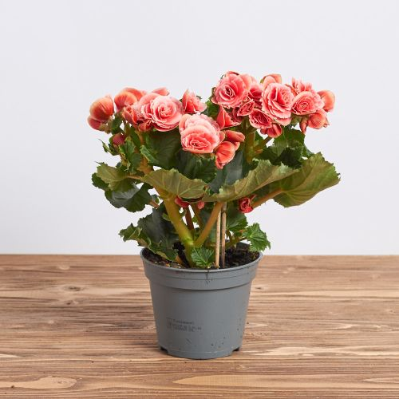
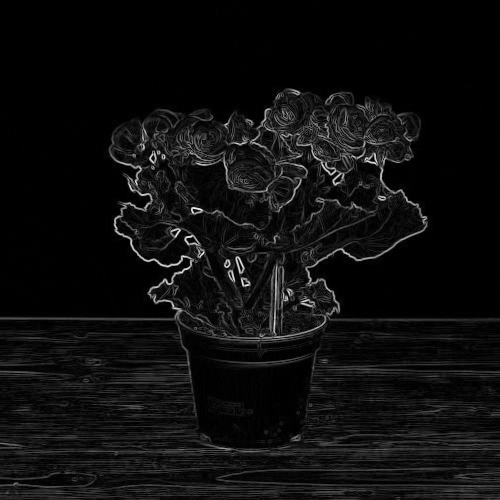
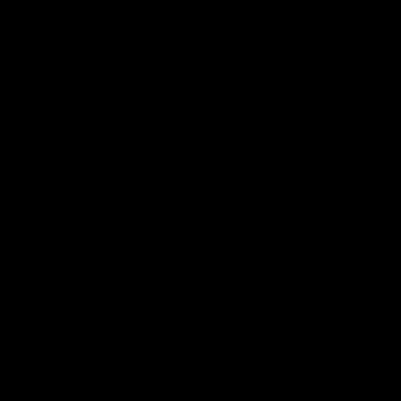
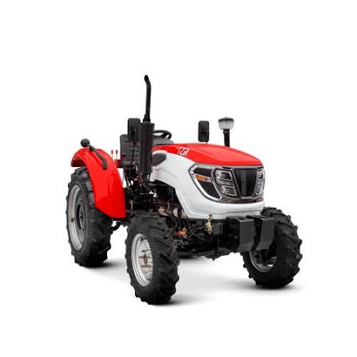
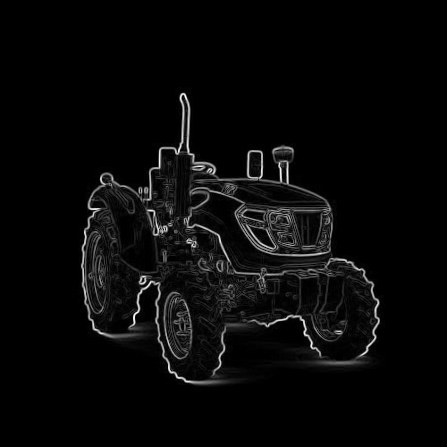
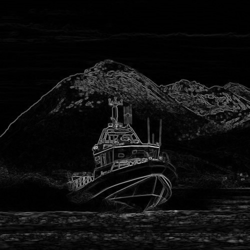

# Лабораторная работа №1

## Оператор Собеля

| № | ИСУ | ФИО | Вариант |
| :-: | :----: | --------------------------- | -: |
| 22 | 310547 | Остапенко Наталья Андреевна | 1 |

## Цель работы

Реализовать оператор Собеля вручную и с помощью OpenCV. Проверить корректность ручной реализации и сравнить скорость работы двух вариантов.

## Теория

После перевода изображения в оттенки серого каждый пиксель хранит яркость от 0 до 255. Оператор Собеля находит участки, в которых яркость соседних пикселей резко меняется.

Для обработки используются два ядра размером 3 на 3.

Ядро по оси X:

```text
-1  0  1
-2  0  2
-1  0  1
```

Ядро по оси Y:

```text
-1 -2 -1
 0  0  0
 1  2  1
```

Первое ядро вычисляет изменение яркости слева направо. Второе вычисляет изменение сверху вниз. Итоговая сила границы определяется по формуле:

```text
G = sqrt(Gx² + Gy²)
```

Большое значение `G` соответствует сильной границе. Малое значение соответствует однородному участку изображения.

## Принцип работы программы

1. Изображение открывается в оттенках серого.
2. Вокруг него добавляется рамка шириной один пиксель.
3. Для каждого пикселя выбирается окно размером 3 на 3.
4. Окно умножается на ядра `Gx` и `Gy`.
5. Вычисляется общая сила границы.
6. Значения переводятся в диапазон от 0 до 255.
7. Полученное изображение сохраняется в папку `results`.

Рамка заполняется копиями крайних пикселей. Ручная версия использует `np.pad` с режимом `edge`. В OpenCV этому соответствует `BORDER_REPLICATE`. Благодаря одинаковому способу заполнения краёв результаты можно сравнивать напрямую.

## Реализация

### Вариант с OpenCV

В библиотечной версии градиенты вычисляются функцией `cv2.Sobel`.

```python
gradient_x = cv2.Sobel(
    image, cv2.CV_32F, 1, 0,
    ksize=3,
    borderType=cv2.BORDER_REPLICATE,
)
gradient_y = cv2.Sobel(
    image, cv2.CV_32F, 0, 1,
    ksize=3,
    borderType=cv2.BORDER_REPLICATE,
)
gradient = np.sqrt(gradient_x**2 + gradient_y**2)
```

### Ручной вариант

Ручная версия последовательно обрабатывает каждый пиксель. Для него выбирается область 3 на 3, которая умножается на оба ядра Собеля.

```python
for y in range(height):
    for x in range(width):
        window = padded[y : y + 3, x : x + 3]
        gradient_x[y, x] = np.sum(window * KERNEL_X)
        gradient_y[y, x] = np.sum(window * KERNEL_Y)
```

Полный код находится в файле [`main.py`](main.py).

## Структура проекта

```text
lab1-sobel-ostapenko/
├── images/          исходные изображения
├── results/         результаты обработки
├── main.py          код программы
├── requirements.txt зависимости
└── README.md        описание лабораторной работы
```

## Установка и запуск

В работе использовались Python 3.9.6, OpenCV 4.14.0 и NumPy 2.0.2.

```bash
python3 -m venv .venv
source .venv/bin/activate
pip install -r requirements.txt
```

Пример запуска:

```bash
python main.py images/image_1.png
```

Программа сохраняет результат OpenCV, результат ручной реализации и изображение с разницей между ними.

## Тестирование

### Изображение 1

| Исходное изображение | OpenCV | Ручная версия | Разница |
|---|---|---|---|
|  |  |  |  |

### Изображение 2

| Исходное изображение | OpenCV | Ручная версия | Разница |
|---|---|---|---|
|  |  |  |  |

### Изображение 3

| Исходное изображение | OpenCV | Ручная версия | Разница |
|---|---|---|---|
|  |  |  |  |

## Сравнение времени

Перед измерением выполнялся один прогревочный запуск. Затем каждая функция запускалась три раза. В таблице указано среднее время одного запуска.

| Изображение | Размер | OpenCV, мс | Ручная версия, мс | Ускорение OpenCV |
|---|---:|---:|---:|---:|
| `image_1.png` | 500 на 500 | 0.599 | 1143.159 | 1907.6 раза |
| `image_2.jpeg` | 447 на 447 | 0.456 | 922.757 | 2021.6 раза |
| `image_3.jpg` | 500 на 500 | 0.516 | 1147.834 | 2225.1 раза |

Средняя разница между результатами во всех тестах составила `0.000`. Чёрные изображения разницы показывают, что значения соответствующих пикселей полностью совпали.

OpenCV выполнил обработку меньше чем за одну миллисекунду. Ручной версии потребовалось примерно от 0.9 до 1.2 секунды. Причиной является последовательный обход пикселей циклами Python. OpenCV выполняет вычисления в оптимизированном скомпилированном коде.

## Вывод

В ходе работы оператор Собеля был реализован вручную и с помощью OpenCV. Обе версии выделили одинаковые границы на трёх тестовых изображениях. Нулевая средняя разница подтверждает корректность ручной реализации.

Библиотечный вариант оказался примерно в 2000 раз быстрее. Ручную версию можно ускорить с помощью векторных операций NumPy, компиляции циклов через Numba, разделения двумерных ядер на одномерные проходы и параллельной обработки строк.

Способ заполнения краёв зависит от задачи. Края можно заполнить постоянным значением, скопировать, отразить или зациклить. Выбранный способ влияет на результат возле границы изображения. В этой работе использовано копирование крайних пикселей, чтобы избежать искусственного перехода к нулю и получить одинаковые результаты двух реализаций.

## Источники

1. [OpenCV. Sobel Derivatives](https://docs.opencv.org/4.x/d2/d2c/tutorial_sobel_derivatives.html)
2. [NumPy. Функция pad](https://numpy.org/doc/stable/reference/generated/numpy.pad.html)
3. [OpenCV. Типы заполнения границ](https://docs.opencv.org/4.13.0/d2/de8/group__core__array.html)
4. [NumPy. Sliding window view](https://numpy.org/doc/stable/reference/generated/numpy.lib.stride_tricks.sliding_window_view.html)
5. [Numba. Рекомендации по оптимизации](https://numba.readthedocs.io/en/stable/user/performance-tips.html)
